# design-system

Design tokens for [wonmor.io](https://wonmor.io), packaged as `@wonmor/tokens`: 115 values for colour, type, spacing, radius and motion, as CSS custom properties and JSON.

[](https://scorecard.dev/viewer/?uri=github.com/wonmortech/design-system)


**[Website](https://wonmor.io) · [Live demo](https://wonmor.io/demo/design-system/)**

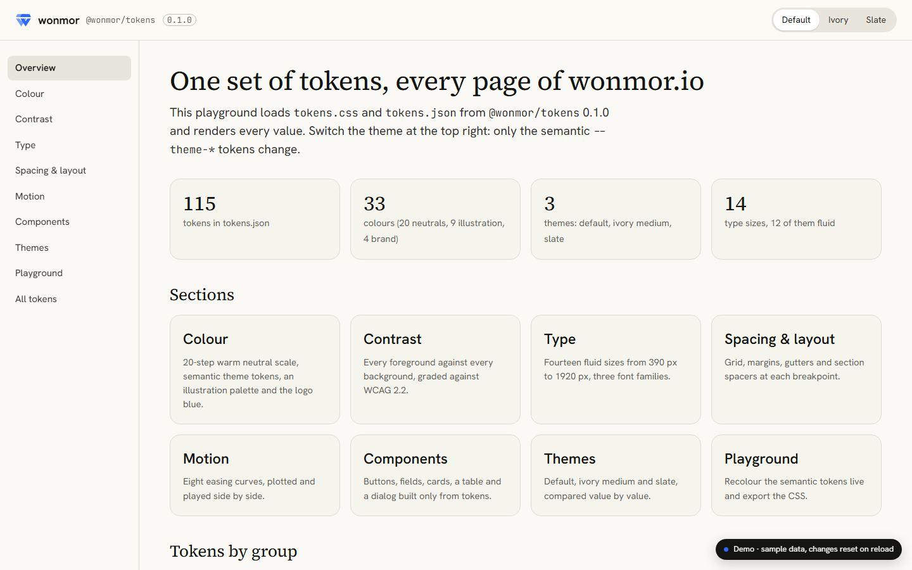

## What it does

- **One file to import.** [`tokens/tokens.css`](tokens/tokens.css) puts every token on `:root`, with responsive overrides, two theme classes and `@font-face` rules.
- **Same values as JSON.** [`tokens/tokens.json`](tokens/tokens.json) carries each value, the custom property it points to (`ref`), breakpoints and fluid-type limits, for tools and other platforms.
- **Themes by class.** `.theme-slate` (dark) and `.theme-ivory-medium` only redefine the semantic `--theme-*` tokens, so they work on any subtree.
- **Fluid type.** 14 sizes; 12 interpolate linearly between a 390 px and a 1920 px viewport.
- **A grid that grows.** 4 columns below 768 px, 12 above; margins and section spacers step up at 768 and 1280 px.
- **Named motion.** Eight `cubic-bezier` easings (`--ease-out-quart`, `--ease-rise`, …) used for hovers, dialogs and theme swaps.

The [live demo](https://wonmor.io/demo/design-system/) is a playground that loads the two files above and renders every value: swatches, a contrast matrix, a type scale with a viewport slider, a grid simulator, easing curves you can play, component previews and a recolouring playground that exports CSS.

| | |
|---|---|
| 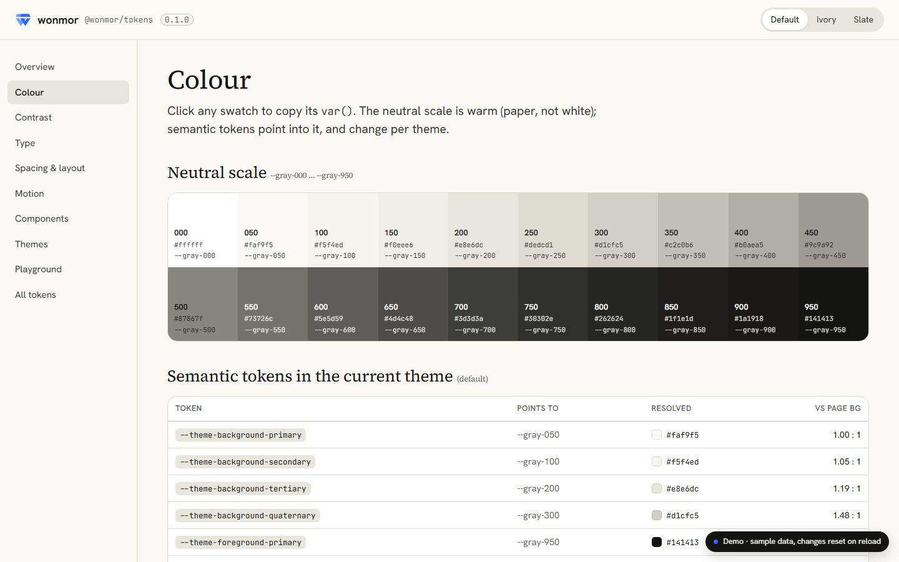 | 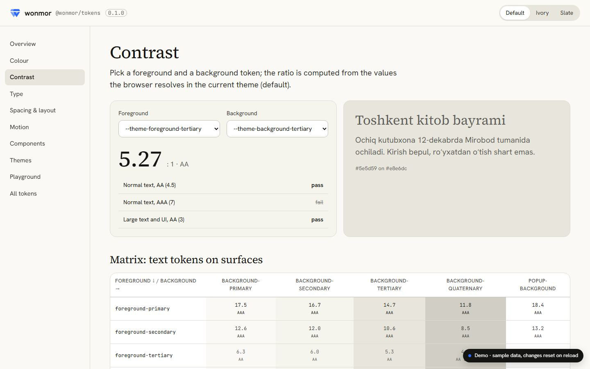 |
| **Colour.** 20 warm neutrals, semantic tokens resolved live, illustration and logo colours. | **Contrast.** Any foreground on any background, graded AA / AAA, plus the full matrix. |
| 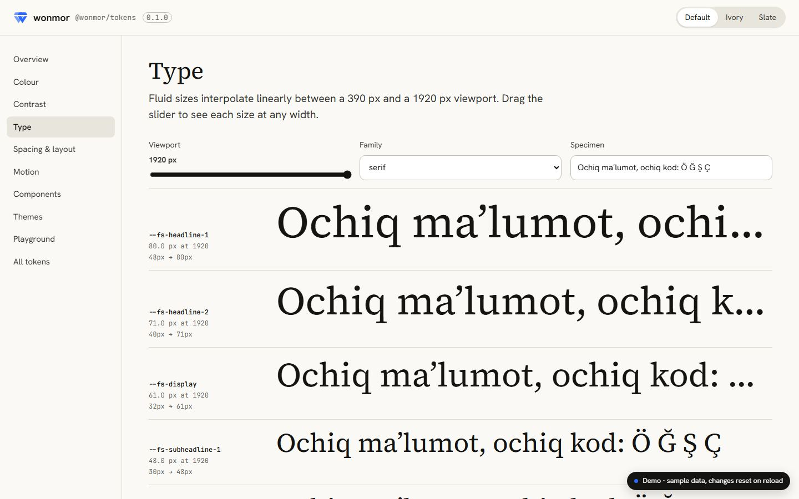 | 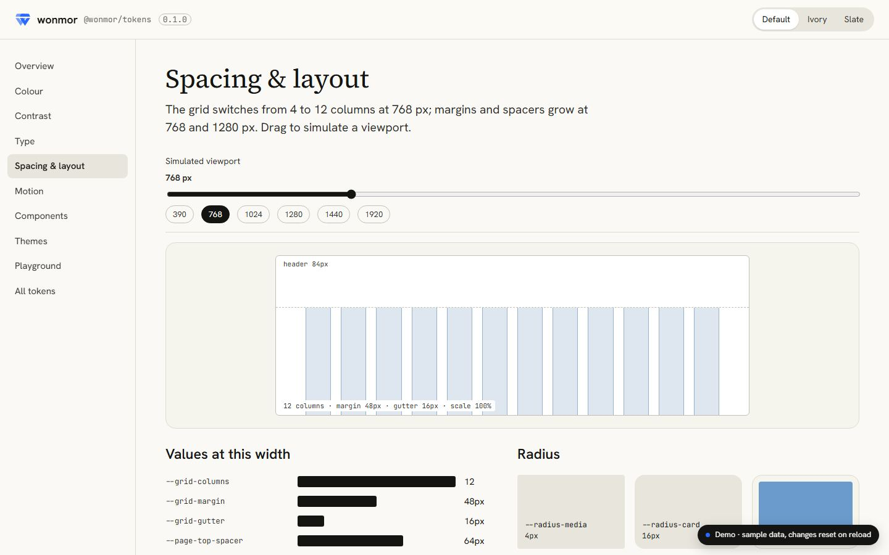 |
| **Type.** Every size at any viewport width between 390 and 1920 px, in all three families. | **Spacing & layout.** Columns, margins and spacers at each breakpoint. |
| 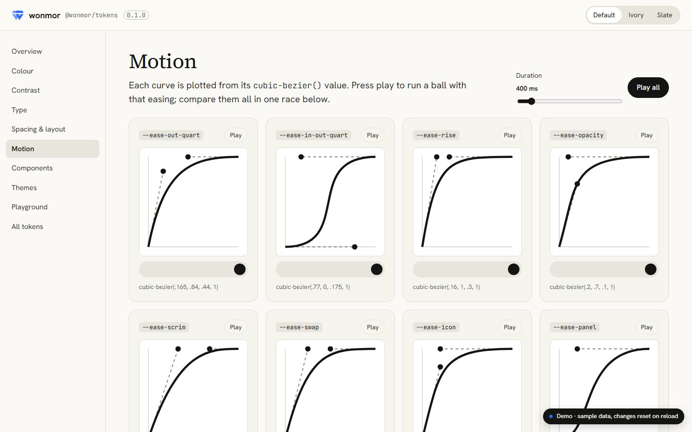 | 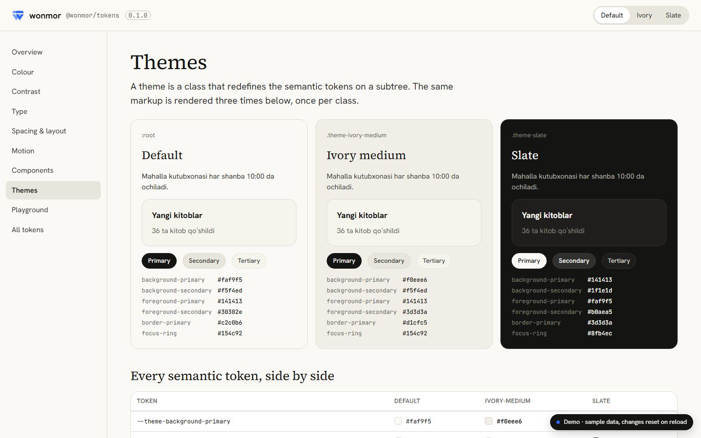 |
| **Motion.** Each easing plotted from its value, played alone or in one race. | **Themes.** Default, ivory medium and slate, value by value. |
| 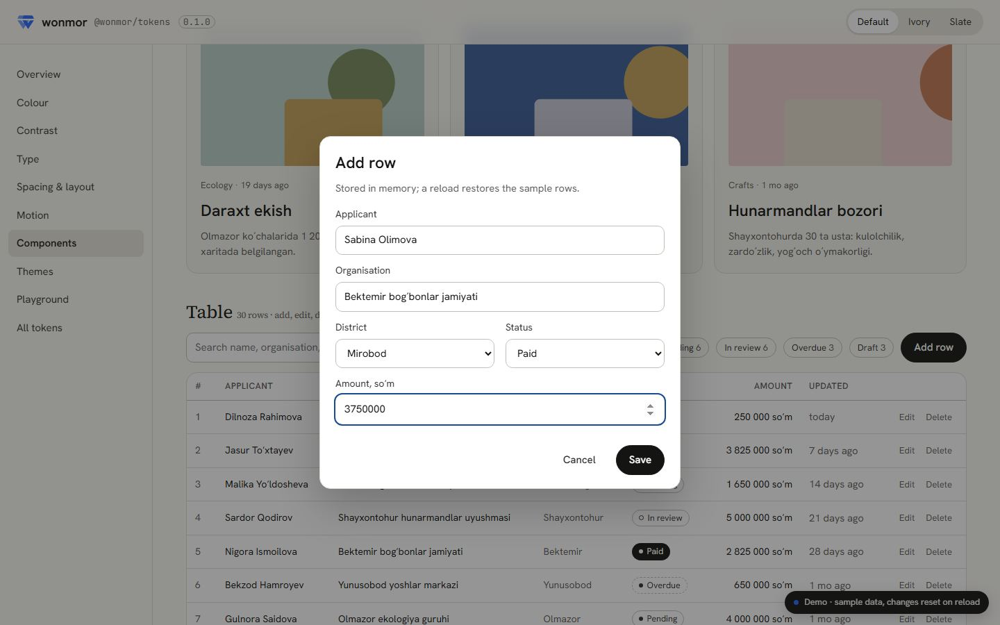 | 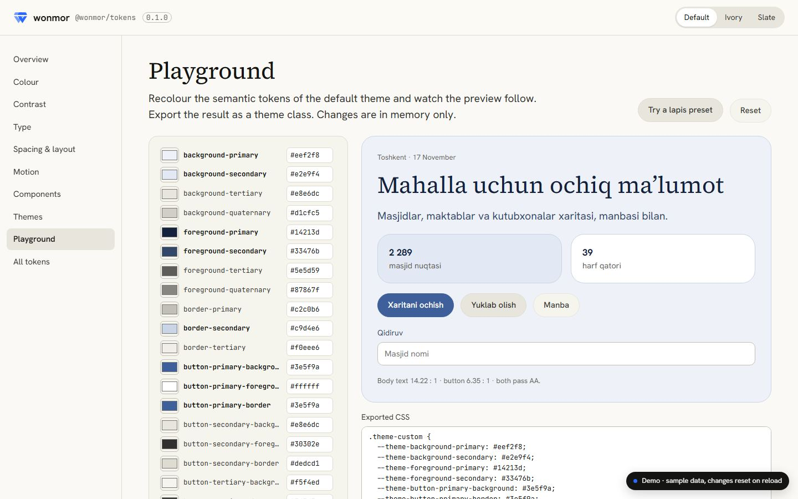 |
| **Components (preview).** Buttons, fields, cards, a table with add/edit/delete, a dialog. | **Playground.** Recolour the semantic tokens, check contrast, export a theme class. |
| 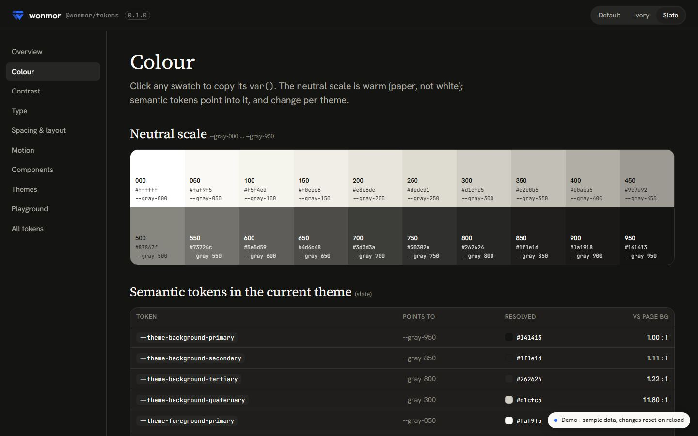 | 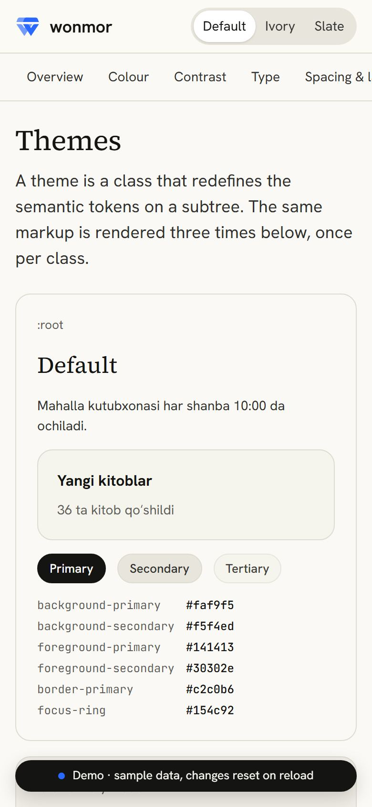 |
| **Slate.** The whole playground switches with one class on `<body>`. | **Phone.** The same pages at 390 px. |

## Quick start

The package is named `@wonmor/tokens` but is **not published to npm yet**. Install from git, or copy the two files:

```bash
npm install github:wonmortech/design-system
```

```css
@import "@wonmor/tokens/tokens.css";

body {
  font-family: var(--sans);
  font-size: var(--fs-body-3);
  background: var(--theme-background-primary);
  color: var(--theme-foreground-primary);
}

.card {
  background: var(--theme-background-secondary);
  border: 1px solid var(--theme-border-secondary);
  border-radius: var(--radius-card);
  transition: transform 400ms var(--ease-out-quart);
}

/* A dark band: the class only swaps the semantic tokens, so set background and colour yourself. */
.theme-slate {
  background: var(--theme-background-primary);
  color: var(--theme-foreground-primary);
}
```

Rules the site follows:

- Components use the semantic `--theme-*` tokens, never raw `--gray-*` values or hex.
- `--ill-*` colours are for illustrations only, never for UI chrome.
- `--wm-*` colours are for the Wonmor logo only.

Components (button, card, header, footer) are **planned**; the ones in the demo are previews built from the tokens, and nothing is published for them yet.

## Tokens

| Group | Tokens | Notes |
|---|---|---|
| Neutral scale | `--gray-000` … `--gray-950` | 20 steps, `#ffffff` … `#141413` |
| Semantic | `--theme-background-*`, `--theme-foreground-*`, `--theme-border-*`, `--theme-button-{primary,secondary,tertiary}-*`, `--theme-popup-background`, `--theme-focus-ring` | Page background `#faf9f5`, text `#141413`, focus `#154c92` (`#8fb4ec` in slate) |
| Illustration | `--ill-oat`, `olive`, `cactus`, `sky`, `heather`, `coral`, `gold`, `lapis`, `clay` | Illustrations only |
| Brand | `--wm-blue` `#2969FF`, `--wm-ink` `#090A1E` | Logo only |
| Type | `--fs-headline-1` (48→80 px) … `--fs-body-4` (14→15 px), `--fs-caption-1` 13 px, `--fs-caption-2` 11 px | Fluid between 390 and 1920 px |
| Layout | `--grid-columns` 4 / 12, `--grid-margin` 32 / 48 / 80 px, `--grid-gutter` 16 px, `--page-top-spacer`, `--section-spacer-sm`, `--section-spacer-lg` | Steps at 768 and 1280 px; `--grid-max-width` 1920 px, `--header-nav-height` 84 px, `--reading-width` 660 px |
| Radius | `--radius-media` 4 px, `--radius-card` 16 px | |
| Easing | `--ease-out-quart`, `--ease-in-out-quart`, `--ease-rise`, `--ease-opacity`, `--ease-scrim`, `--ease-swap`, `--ease-icon`, `--ease-panel` | |
| Fonts | `--sans` (Wm Sans), `--serif` (Wm Serif), `--mono` (Wm Mono) | With system fallbacks |

Every value, with its `ref` and breakpoints, is in [`tokens.json`](tokens/tokens.json) and on the demo's [All tokens](https://wonmor.io/demo/design-system/#/tokens) page.

## Fonts

Font files are **not included**. `tokens.css` loads them from `../fonts/` relative to `tokens/tokens.css`; without them the stacks fall back to system fonts. All four are open fonts under the [SIL Open Font License 1.1](https://openfontlicense.org/):

| Family in CSS | Font | Files expected |
|---|---|---|
| Wm Sans (Latin) | [Hanken Grotesk](https://github.com/marcologous/hanken-grotesk), © 2021 The Hanken Grotesk Project Authors | `sans-latin.woff2`, `sans-latin-ext.woff2` |
| Wm Sans (Cyrillic) | [Onest](https://github.com/simpals/onest), © 2021 The Onest Project Authors | `sans-cyrillic.woff2`, `sans-cyrillic-ext.woff2` |
| Wm Serif | Source Serif 4, © Google Inc. | `serif-latin.woff2`, `serif-latin-ext.woff2`, `serif-cyrillic.woff2`, `serif-latin-italic.woff2` |
| Wm Mono | [JetBrains Mono](https://github.com/JetBrains/JetBrainsMono), © 2020 The JetBrains Mono Project Authors | `mono-latin.woff2`, `mono-cyrillic.woff2` |

wonmor.io, and the demo build in [`tools/build-demo.mjs`](tools/build-demo.mjs), take the variable-font subsets from the `@fontsource-variable/hanken-grotesk`, `onest`, `source-serif-4` and `jetbrains-mono` npm packages and rename them to the file names above. If you redistribute the fonts, include each font's OFL licence text.

## Development

The package itself has no build step. The demo is plain HTML, CSS and JavaScript in [`demo/`](demo/); the dev dependencies are only Playwright and the font packages.

```bash
npm ci
npm run demo               # build to dist/demo/design-system/ and serve on http://127.0.0.1:4280/demo/design-system/
npm run test:demo          # Playwright smoke test: every page, theme switch, table CRUD, playground export
npm run site:screenshots   # regenerate docs/screenshots/*.jpg from the demo
```

The demo is served under the same Content-Security-Policy as wonmor.io and is not part of the npm package (`files` lists only `tokens/`, `LICENSE` and `README.md`).

## Licence

Tokens and documentation: [MIT](LICENSE). The fonts are not part of this repository and keep their own licence (OFL 1.1).
